<div align="center">

# 📈 TradingAgents India

### A local-first, multi-agent AI research workbench for Indian equities

Bull vs. bear debates · point-in-time evidence · deterministic indicators · paper trading — all running on **your** machine.


<!-- Add a screenshot or GIF here:  -->

</div>

---

## Why TradingAgents India?

Most "AI trading" demos let an LLM guess a price. This project treats the LLM as **one voice in a structured, auditable research process**:

- 🧠 **A full research desk, not a chatbot.** Market, News, Sentiment and Fundamentals analysts feed Bull and Bear researchers who debate; a Research Manager, Trader, three-way Risk debate and Portfolio Manager then reach a verdict.
- 🕰️ **No look-ahead bias.** Every news item, event and financial fact carries a publication timestamp. Anything published after the analysis date is excluded, and agents are told to cite sources and disclose conflicts.
- 📐 **Numbers come from code, not the model.** EMA/RSI/ATR/VWAP, support/resistance, Fibonacci levels and stop/target suggestions are computed deterministically on FYERS candles. The LLM interprets; it cannot overwrite the maths.
- 🛡️ **Safe by default.** Research and paper trading only. Live orders are disabled and sit behind multiple explicit gates. Risk rejections can't be overridden by the manager.
- 🔍 **Fully auditable.** An *Execution Flow* page shows which agents and tools ran, which data source each used, and what was unavailable, rather than quietly filling gaps.
- 🏠 **Local-first and model-agnostic.** Runs on loopback, keeps data in SQLite, and works with OpenAI, Anthropic, Google, Azure, Bedrock or local Ollama models.

> Built on the open-source [TradingAgents](https://github.com/TauricResearch/TradingAgents) framework by Tauric Research, extended for the Indian market.

---

## How it works

```mermaid
flowchart LR
    subgraph Data["Point-in-time evidence"]
        F[FYERS candles<br/>Daily · 4H · 1H]
        N[News & events<br/>Wigolo / RSS / NSE]
        X[Fundamentals<br/>statements & flags]
        M[Market regime<br/>& catalysts]
    end
    Data --> E[Evidence package<br/>timestamp-filtered]
    E --> A[Analysts<br/>Market · News · Sentiment · Fundamentals]
    A --> D[Bull ⚔ Bear debate]
    D --> R[Research Manager]
    R --> T[Trader proposal]
    T --> K[Risk debate<br/>Aggressive · Neutral · Conservative]
    K --> P[Portfolio Manager<br/>final verdict]
    P --> U[Dashboard · reports · paper orders]
```



There are two complementary workflows:

| Workflow | What it is |
|---|---|
| **Full Analysis** | The original multi-agent debate graph, fed by the India evidence package. |
| **Research pipeline** | A lean, deterministic LangGraph pipeline: Fundamental → Technical → Trader → Risk → Hedge-Fund Manager. It fails closed to `NEEDS_REVIEW`, has its own API and stores results in SQLite. |

---

## Features

| Area | What you get |
|---|---|
| **Technical analysis** | Multi-timeframe (Daily/4H/1H) EMA 20/50/100/200, RSI, ATR, VWAP, structure, Fibonacci, relative volume |
| **Universe & scanner** | NIFTY 50 / NIFTY 500 registry, background batch scans with job polling |
| **Fundamentals** | Bulk statement import, valuation, financial-health flags, NIFTY 500 fundamental screen |
| **News & events** | Source-linked news, rule-based event classification (RBI, SEBI, results, corporate actions), deep-research briefs |
| **Calendar** | Fed/RBI/NSE holidays, earnings & corporate actions, optional Google Calendar sync |
| **Market movers** | NIFTY 500 movers and a saved scanner snapshot used for regime/breadth context |
| **Portfolio risk** | Exposure and concentration checks that refuse to invent missing prices |
| **Paper trading** | Simulated orders, positions and P&L |
| **Backtesting** | CLI sweep scoring past decisions over a ticker × date grid |
| **Observability** | Execution audit page, optional LangSmith tracing |

---

## Quick start

**Requirements:** Python 3.11+ (3.13 recommended). Node.js is optional, for the Wigolo web-research daemon.

```bash
git clone https://github.com/<your-username>/tradingagents-india.git
cd tradingagents-india

# macOS / Linux
chmod +x start.sh && ./start.sh

# Windows (Command Prompt)
start.bat
```

The launcher creates a virtual environment, installs dependencies, creates `.env` from `.env.example`, and starts the app. Then open:

- 🖥️ Dashboard: <http://127.0.0.1:8000/>
- 📚 API docs: <http://127.0.0.1:8000/docs>
- ❤️ Health: <http://127.0.0.1:8000/api/health>

<details>
<summary><b>Manual install</b></summary>

```bash
python -m venv .venv && source .venv/bin/activate
pip install -e '.[web]'
cp .env.example .env
uvicorn tradingagents.web.app:app --host 127.0.0.1 --port 8000
```
</details>

### What keys do I need?

| Purpose | Variable(s) | Required? |
|---|---|---|
| LLM provider | e.g. `OPENAI_API_KEY`, `ANTHROPIC_API_KEY`, `GOOGLE_API_KEY`, or a local Ollama endpoint | For LLM analysis |
| Indian market data | `FYERS_APP_ID`, `FYERS_ACCESS_TOKEN` | For technicals |
| Web research | Wigolo daemon (auto-started) | Optional, falls back to Google News RSS |
| Extra news / events | `INDIANAPI_API_KEY`, `COINMARKETCAL_API_KEY` | Optional |
| Tracing | `LANGSMITH_API_KEY` | Optional |

Switch models without touching code, for example `TRADINGAGENTS_LLM_PROVIDER=ollama` in `.env`.

---

## Usage

**Dashboard.** Pick a symbol, then run *Technical analysis*, *Integrated research* or *Full Analysis*, and inspect the run on the *Execution Flow* page.

**REST API**

```bash
# Deterministic multi-timeframe technicals
curl "http://127.0.0.1:8000/api/analysis/SBIN?lookback_days=365"

# Integrated evidence workflow
curl -X POST http://127.0.0.1:8000/api/research/SBIN \
  -H "Content-Type: application/json" \
  -d '{"lookback_days":365,"include_15m":false,"refresh_news":true,"use_llm":false}'

# Background scan of the NIFTY 50 universe
curl -X POST http://127.0.0.1:8000/api/scan -H "Content-Type: application/json" -d '{"symbols":[]}'
```

**Research-pipeline API** (separate, research-only):

```bash
uvicorn tradingagents.india.langgraph_pipeline.api_main:app --host 127.0.0.1 --port 8000
```

**CLI**

```bash
tradingagents                                              # interactive analysis
tradingagents backtest NVDA,AAPL --start 2026-01-01 --end 2026-06-30 --every 7
```

**Python**

```python
from tradingagents.graph.trading_graph import TradingAgentsGraph
from tradingagents.default_config import DEFAULT_CONFIG

ta = TradingAgentsGraph(debug=True, config=DEFAULT_CONFIG.copy())
_, decision = ta.propagate("RELIANCE.NS", "2026-09-01")
print(decision)
```

---

## Project layout

```
tradingagents/
├── agents/            # analysts, researchers, managers, risk debators, trader
├── graph/             # LangGraph setup, propagation, checkpointing
├── india/             # FYERS, indicators, events, fundamentals, regime, paper trading
│   └── langgraph_pipeline/   # lean research pipeline + API (agents/<name>/agent.py)
├── dataflows/         # data vendors and routing (Yahoo, Alpha Vantage, SEC, FRED, …)
├── llm_clients/       # OpenAI, Anthropic, Google, Azure, Bedrock, Ollama adapters
├── memory/            # decision log and reflection
└── web/               # FastAPI app and single-page dashboard
cli/                   # interactive CLI and backtest command
scripts/               # launcher and .env checks
tests/                 # 1,500+ tests
docs/                  # detailed guide, architecture, API reference
```

---

## Safety & disclaimer

> ⚠️ **This is research software, not financial advice.** Models, data feeds and news sources can be wrong, stale or incomplete. Never trade on a single model output.

- The app binds to `127.0.0.1` by default. Don't expose it publicly without adding authentication.
- Paper trading is the default. Live FYERS and Kite order paths are disabled and gated behind several explicit environment switches and confirmation phrases. They have **not** been validated against real accounts.
- Keep `.env` out of version control; never paste tokens into chat or issues.
- Respect each data provider's terms. Moneycontrol access is blocked unless you confirm permission.

---

## Testing

```bash
pip install -e '.[web,dev]'
pytest
```

Integration tests that need external services are excluded by default (`pytest -m integration`). A small number of tests currently fail in a clean environment (mostly UI and dashboard-content assertions); see the issue tracker.

---

## Documentation

- 📘 [Detailed guide](docs/DETAILED_GUIDE.md): every endpoint, FYERS/Wigolo/LangSmith/Google Calendar setup, bulk fundamentals, live-order gates
- 🏗️ [Architecture & flow](docs/TradingAgents_India_Architecture_and_Flow.md)
- ✅ [Implementation status](docs/TradingAgents_India_Implementation_Status.md)
- 🔌 [Research-pipeline API](docs/langgraph_pipeline_api.md)

## Roadmap

- [ ] Live index-constituent feeds and historical membership
- [ ] Official NSE XBRL normalization for fundamentals
- [ ] Automated protective stop/target handling and order reconciliation
- [ ] Walk-forward backtests for the India workflow
- [ ] Docker image tuned for the web dashboard

## Contributing

Issues and pull requests are welcome. Please run `ruff check .` and `pytest` before opening a PR, and keep changes research-only and safe by default.

## Credits & license

Built on [TauricResearch/TradingAgents](https://github.com/TauricResearch/TradingAgents). Uses [LangGraph](https://github.com/langchain-ai/langgraph), [FastAPI](https://fastapi.tiangolo.com/), FYERS market-data APIs and, optionally, the separately installed [Wigolo](https://www.npmjs.com/package/wigolo) service (AGPL-3.0, not bundled).

Released under the [Apache License 2.0](LICENSE).

<div align="center">

**If this project helps your research, a ⭐ goes a long way.**

</div>
